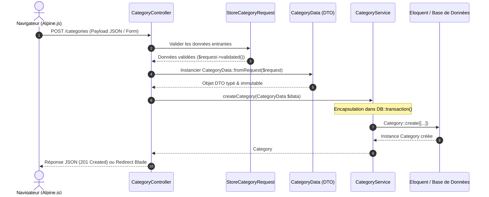

# Phase 2 : PLAN — Architecture du Service Layer & Modélisation DTO

> **Étape 2 du Playbook SDLC :** Établir le plan d'architecture logicielle, le découpage des responsabilités et les flux de données avant d'implémenter les classes.

---

## 1. Diagramme de Flux Architectural (Laravel 12 Service Layer)

---

## 2. Découpage Strict des Responsabilités (Separation of Concerns)

1. **La Vue Réactive ([`index.html`](file:///d:/labs-agent-dev/lab-skills-framework/4.realisation/3-build/index.html)) :**
   - Responsabilité : Gérer l'état de l'interface (ouverture du modal, génération temps réel du slug via `slugify()`, debounce de recherche, affichage des toasts).
   - Interdiction : Aucune logique métier complexe.
2. **Le Contrôleur HTTP ([`CategoryController.php`](file:///d:/labs-agent-dev/lab-skills-framework/4.realisation/3-build/app/Http/Controllers/CategoryController.php)) :**
   - Responsabilité : *Thin controller* pur. Il injecte `CategoryServiceInterface`, valide via `StoreCategoryRequest`, convertit en `CategoryData` et renvoie la réponse HTTP adaptée (Blade ou JSON).
   - Interdiction : Aucun appel direct à `Category::create()` ou `DB::transaction()` dans le contrôleur.
3. **Le Data Transfer Object ([`CategoryData.php`](file:///d:/labs-agent-dev/lab-skills-framework/4.realisation/3-build/app/DTO/CategoryData.php)) :**
   - Responsabilité : Objet typé en PHP 8.2+ (`readonly`) qui garantit l'intégrité des types entre la couche HTTP et la couche métier.
4. **Le Service Métier ([`CategoryService.php`](file:///d:/labs-agent-dev/lab-skills-framework/4.realisation/3-build/app/Services/CategoryService.php)) :**
   - Responsabilité : Implémente `CategoryServiceInterface`. Encapsule la persistance, gère les transactions SQL, applique les règles métier (normalisation, journalisation) et optimise les requêtes avec `withCount('posts')`.
5. **Le Modèle Eloquent ([`Category.php`](file:///d:/labs-agent-dev/lab-skills-framework/4.realisation/3-build/app/Models/Category.php)) :**
   - Responsabilité : Mapping relationnel, définition des relations (`hasMany(Post::class)`), attributs mass-assignment sécurisés (`$fillable`) et scopes locaux (`scopeActive`, `scopeSearch`).

---

## 3. Checkpoint Humain (Garde-Fou Playbook)
- [x] Le diagramme de flux respecte-t-il la séparation des couches ?
- [x] L'absence de logique métier dans le contrôleur est-elle formellement garantie ?

