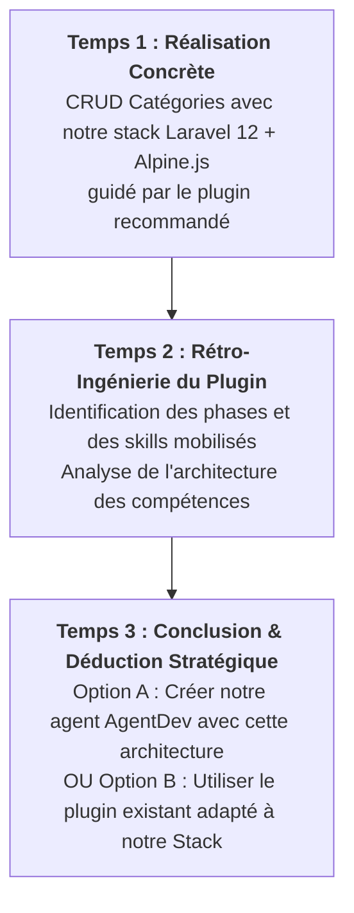

# Travail à Réaliser : 4. Réalisation & Banc d'Essai (Expérimentation du Plugin)

Ce dossier accueille le cas pratique étalon développé par l'apprenant, l'expérimentation du plugin recommandé par l'étude comparative et l'analyse de son architecture de compétences.

---

## 🎯 Rôle de ce Fichier `README.md`
Conformément aux règles de gouvernance du framework (`lab-rules.md`) et au principe de **non-substitution** :
- **Consignes de travail :** Ce document explicite le travail d'expérimentation pratique à réaliser par l'apprenant.
- **Espace réservé à l'apprenant :** Le dossier `4.realisation/` ne contient initialement que ce `README.md`. L'apprenant y construit son application étalon sans substitution par l'IA.
- **Quality Gate 3 :** Il définit les critères de validation requis avant de pouvoir formaliser la décision d'architecture (ADR) dans `3.spec-skill/`.

---

## 🎯 Objectif Technique
Réaliser une application étalon de **gestion des catégories** conforme à notre stack technique (**PHP 8.2+ / Laravel 12 avec Service Layer, DTOs, Form Requests, Alpine.js réactif, Tailwind CSS et Preline UI**) en mobilisant le **plugin recommandé par l'étude comparative** (`2.etude-comparative/`), disséquer son fonctionnement, et en déduire la stratégie d'architecture pour notre agent **`AgentDev`**.

---

## 📋 Travail Concret à Réaliser par l'Apprenant

Le travail d'expérimentation se déroule en **trois temps forts** :

### 1. Réalisation du Cas Étalon avec le Plugin Recommandé
- Implémenter l'application de gestion des catégories en suivant rigoureusement le flux imposé par le plugin sélectionné à l'issue de l'étape 2 (ex: Playbook SDLC en 6 phases : *Define, Plan, Build, Verify, Review, Ship*).
- Respecter l'ensemble des contraintes de notre stack de référence :
  - **Backend Laravel 12 :** Contrôleur fin (`thin controller`), DTO typé immutable (`CategoryData`), Service métier encapsulant les transactions (`CategoryService`), Form Requests pour la validation et requêtes optimisées (élimination stricte des requêtes $N+1$ via `withCount`).
  - **Frontend Réactif :** Composants Alpine.js 3.x (`x-data`), Tailwind CSS et Preline UI (recherche en temps réel, pagination dynamique, modals accessibles et notifications toasts).

### 2. Analyse des Phases & de l'Architecture des Skills du Plugin
- Dresser l'inventaire complet des **phases de travail** et des **skills individuels** activés par le plugin lors du développement.
- Analyser la façon dont le plugin a architecturé ses compétences :
  - Quelle est la granularité des skills (spécialisés vs généralistes) ?
  - Comment le plugin assure-t-il la transition et le passage de contexte entre les phases ?
  - Quels sont les garde-fous mis en place contre le code spaghetti ou les régressions ?

### 3. Conclusion & Déduction Stratégique pour notre Agent
À partir des résultats réels obtenus sur le banc d'essai, formuler une analyse critique et arbitrer entre deux démarches possibles :
- **Option A (Création Propre) :** Concevoir pour notre agent **`AgentDev`** une architecture de compétences propriétaire qui reprend les mêmes phases et principes d'organisation des skills observés.
- **Option B (Adaptation du Plugin) :** Conserver et exploiter le plugin open-source existant, en lui adjoignant une couche d'adaptation et des règles strictes dédiées à notre stack (Laravel Service Layer, Alpine.js, conventions Solicode).

---

## 🔍 Validation de la Porte de Passage (Gate 3)
- [ ] L'application de gestion des catégories est fonctionnelle et respecte l'ensemble des critères de la stack.
- [ ] Le plugin recommandé a été expérimenté et son flux de travail a été éprouvé.
- [ ] Les phases et skills du plugin sont documentés et leur architecture analysée.
- [ ] La conclusion stratégique (Créer nos skills vs Adapter le plugin) est formulée pour servir de base directe à la décision d'architecture (ADR) dans `3.spec-skill/`.
