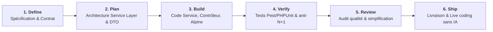

# Travail à Réaliser : 4. Réalisation & Banc d'Essai (Testbench Étalon)

Ce dossier accueille les expérimentations, le code du banc d'essai et les tests comparatifs réalisés par l'apprenant.

---

## 🎯 Rôle de ce Fichier `README.md`
Conformément aux règles de gouvernance du framework (`lab-rules.md` et principe de non-substitution) :
- **Consignes de travail :** Ce document explicite le travail d'expérimentation pratique à réaliser par l'apprenant.
- **Espace de travail réservé à l'apprenant :** Le dossier `4.realisation/` ne contient initialement que ce `README.md` afin de laisser l'apprenant monter son banc d'essai sans substitution par l'IA.
- **Quality Gate 3 :** Il définit les critères de validation requis avant de pouvoir formaliser la spécification technique dans `3.spec-skill/`.

---

## 🎯 Objectif Technique
Concevoir et tester le cas d'usage étalon commun (banc d'essai) pour comparer les hypothèses techniques posées à l'issue de l'étape 2 (`2.etude-comparative/`) et mesurer concrètement leur conformité avec notre stack : **PHP 8.2+ / Laravel 12 avec Service Layer, DTOs, Form Requests et Alpine.js réactif**.

---

## 📋 Travail Concret à Réaliser par l'Apprenant

L'apprenant met en œuvre le cycle de réalisation articulé autour des 6 phases du modèle Playbook :

| Phase | Sous-Dossier à Créer | Travail Attendu & Livrables |
| :--- | :--- | :--- |
| **1. DEFINE** | `1-define/` | Spécifier les règles métier du CRUD étalon et définir le contrat d'interface (`CategoryServiceInterface`). |
| **2. PLAN** | `2-plan/` | Modéliser l'architecture en couches, le flux de données (MVC ➔ DTO ➔ Service ➔ Eloquent) et les routes HTTP. |
| **3. BUILD** | `3-build/` | Implémenter le code complet : DTO typé (`CategoryData`), Service métier (`DB::transaction`), Thin controller et interface réactive Alpine.js + Tailwind. |
| **4. VERIFY** | `4-verify/` | Écrire et exécuter les tests unitaires et d'intégration (Pest / PHPUnit) et vérifier l'absence de requêtes $N+1$. |
| **5. REVIEW** | `5-review/` | Réaliser l'audit qualité de code, les vérifications anti-rationalisation et le respect des conventions d'équipe. |
| **6. SHIP** | `6-ship/` | Préparer la fiche de livraison, la documentation de démonstration et répéter le live coding sans IA. |

---

## 🔍 Validation de la Porte de Passage (Gate 3)
- [ ] Le banc d'essai fonctionne correctement et implémente les fonctionnalités attendues.
- [ ] Les métriques de comparaison (lisibilité, respect de la stack, consommation de tokens, maintenabilité) sont collectées.
- [ ] Les enseignements pratiques sont consolidés pour servir de base à l'ADR dans `3.spec-skill/`.
