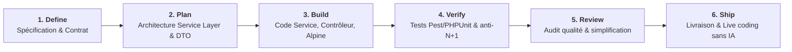

# 4. Réalisation & Banc d'Essai : Le Playbook SDLC d'Addy Osmani en Action

Ce dossier concrétise le modèle **Playbook SDLC** (inspiré de [`skills.addy.ie`](https://skills.addy.ie/) / Addy Osmani), adapté à notre stack : **PHP 8.2+ / Laravel 12 avec Service Layer, DTOs, Form Requests et Alpine.js réactif**.

---

## 🎯 Objectif Technique
Démontrer comment un agent d'ingénierie (`AgentDev`) exécute un cycle de livraison complet en 6 phases sans bâcler le code, en éliminant les régressions et en garantissant une séparation stricte des responsabilités logicielles.

---

## 📁 Organisation des 6 Phases dans `4.realisation/`

| Phase Playbook | Dossier | Livrables Produits & Rôle |
| :--- | :--- | :--- |
| **Phase 1 : DEFINE** | [`1-define/`](file:///d:/labs-agent-dev/lab-skills-framework/4.realisation/1-define/) | [`specification-crud-categories.md`](file:///d:/labs-agent-dev/lab-skills-framework/4.realisation/1-define/specification-crud-categories.md) : Spécification des règles métier et du contrat fonctionnel. |
| **Phase 2 : PLAN** | [`2-plan/`](file:///d:/labs-agent-dev/lab-skills-framework/4.realisation/2-plan/) | [`architecture-service-layer.md`](file:///d:/labs-agent-dev/lab-skills-framework/4.realisation/2-plan/architecture-service-layer.md) : Diagramme de flux MVC ➔ DTO ➔ Service ➔ Eloquent. |
| **Phase 3 : BUILD** | [`3-build/`](file:///d:/labs-agent-dev/lab-skills-framework/4.realisation/3-build/) | Implémentation logicielle étanche : • [`CategoryData.php`](file:///d:/labs-agent-dev/lab-skills-framework/4.realisation/3-build/app/DTO/CategoryData.php) (DTO typé) • [`CategoryService.php`](file:///d:/labs-agent-dev/lab-skills-framework/4.realisation/3-build/app/Services/CategoryService.php) (Service métier + DB::transaction) • [`CategoryController.php`](file:///d:/labs-agent-dev/lab-skills-framework/4.realisation/3-build/app/Http/Controllers/CategoryController.php) (Thin controller) • [`index.html`](file:///d:/labs-agent-dev/lab-skills-framework/4.realisation/3-build/index.html) (Vue réactive Alpine.js 3.x + Tailwind). |
| **Phase 4 : VERIFY** | [`4-verify/`](file:///d:/labs-agent-dev/lab-skills-framework/4.realisation/4-verify/) | [`CategoryServiceTest.php`](file:///d:/labs-agent-dev/lab-skills-framework/4.realisation/4-verify/CategoryServiceTest.php) : Tests unitaires et fonctionnels avec Pest / PHPUnit. |
| **Phase 5 : REVIEW** | [`5-review/`](file:///d:/labs-agent-dev/lab-skills-framework/4.realisation/5-review/) | [`audit-code-review.md`](file:///d:/labs-agent-dev/lab-skills-framework/4.realisation/5-review/audit-code-review.md) : Audit de simplification de code, détection anti-N+1 et gating qualité. |
| **Phase 6 : SHIP** | [`6-ship/`](file:///d:/labs-agent-dev/lab-skills-framework/4.realisation/6-ship/) | [`fiche-livraison-livecoding.md`](file:///d:/labs-agent-dev/lab-skills-framework/4.realisation/6-ship/fiche-livraison-livecoding.md) : Déploiement et protocole de démonstration en direct sans IA. |
