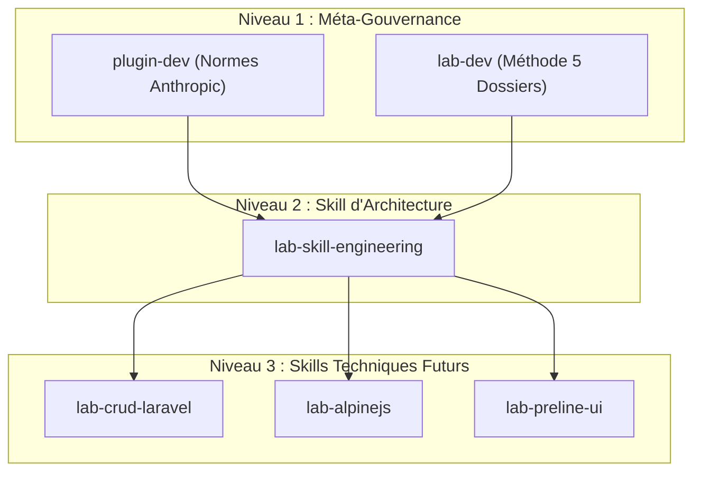

# Réalisation : Matrice d'Architecture des Skills IA

## 1. Cartographie Multi-Niveaux

## 2. Définition des Rôles
| Skill | Niveau | Rôle Opérationnel | Périmètre |
| :--- | :--- | :--- | :--- |
| **`plugin-dev`** | Méta | Conçoit et valide les `SKILL.md` (10 rubriques). | `.agent/skills/*/SKILL.md` |
| **`lab-dev`** | Méta | Cadre les 5 dossiers, Todo.md et slides A1. | `1.besoin/` à `5.rapport-et-presentation/` |
| **`lab-skill-engineering`** | Technique (Actuel) | Cartographie les compétences pour le fil rouge. | `4.realisation/` |
| **`lab-crud-laravel`** | Technique (Futur) | Génère le backend Laravel (Eloquent, FormRequests). | Controllers, Models |
| **`lab-alpinejs`** | Technique (Futur) | Frontend réactif (états, modals, filtres). | `x-data`, vues Blade |
| **`lab-preline-ui`** | Technique (Futur) | Intégration de composants Tailwind accessibles. | Composants Blade UI |

## 3. Contrôle Qualité
- Script `validate-skills.cjs` : **100 % conforme (0 erreur)** sur `lab-dev`, `lab-skill-engineering` et `plugin-dev`.
