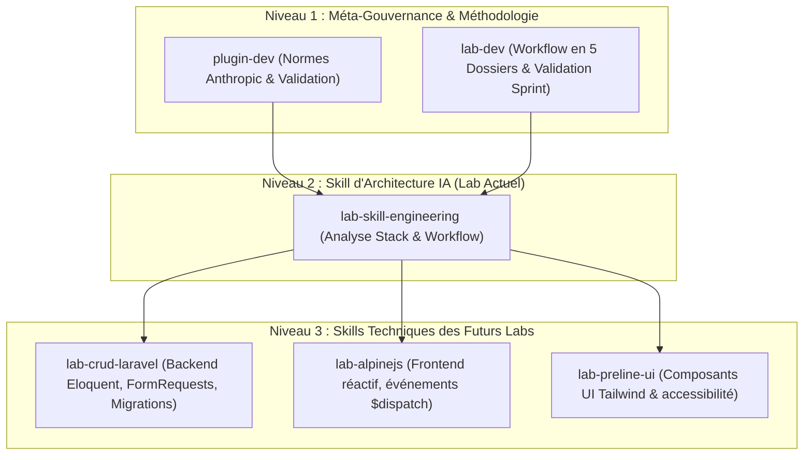

# Réalisation Technique : Matrice et Architecture des Skills IA

Ce document constitue la réalisation technique concrète du Lab actuel sur l'ingénierie des compétences.

---

## 1. Cartographie Complète des Compétences du Projet Fil Rouge

---

## 2. Définition des Rôles par Compétence

| Compétence | Niveau | Rôle Opérationnel | Fichiers Gérés |
| :--- | :--- | :--- | :--- |
| **`plugin-dev`** | Méta | Conçoit et valide les fichiers `SKILL.md` selon les 10 rubriques officielles. | `.agent/skills/*/SKILL.md` |
| **`lab-dev`** | Méta | Structure les 5 sous-dossiers, fournit les templates et valide la soutenance devant le formateur. | `1.besoin/` à `5.rapport-et-presentation/` |
| **`lab-skill-engineering`** | Technique (Actuel) | Détermine la granularité des compétences et guide la cartographie IA pour le prototype fil rouge. | `4.realisation/` & matrices |
| **`lab-crud-laravel`** | Technique (Futur) | Porte les règles Eloquent, MVC et Form Requests pour coder la logique métier. | `app/Http/Controllers/`, `Models/` |
| **`lab-alpinejs`** | Technique (Futur) | Porte les règles de réactivité locale, modals et filtres sans jQuery. | `resources/views/`, `x-data` |
| **`lab-preline-ui`** | Technique (Futur) | Porte les règles d'intégration des composants Tailwind accessibles. | Composants UI Blade |

---

## 3. Résultats des Tests de Validation Déterministe
Le script `validate-skills.cjs` a été exécuté avec succès :
- `lab-dev` : **100% CONFORME** (YAML + Inspiration Anthropic + 10 rubriques).
- `lab-skill-engineering` : **100% CONFORME** (YAML + Inspiration Anthropic + 10 rubriques).
- `plugin-dev` : **100% CONFORME** (YAML + Inspiration Anthropic + 10 rubriques).
- Erreurs bloquantes : **0**.

