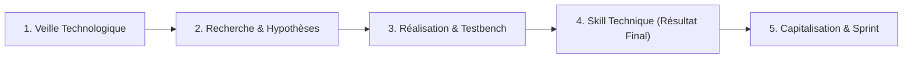

# Démarche Méthodologique d'un Lab Technique

## 1. Les 4 Activités d'Ingénierie

- **Veille :** Explorer les références existantes (`skills.sh`, Anthropic).
- **Hypothèses :** Poser les alternatives d'organisation (technologie, couche, workflow, skill unique).
- **Réalisation (Testbench) :** Expérimenter et comparer les options sur un cas pratique étalon (`4.realisation/`).
- **Skill Technique (Résultat Final) :** Choisir **une seule approche** et concevoir le skill dédié (`3.skill-technique/`).
- **Capitalisation & Sprint :** Rapport + Slides A1 (`5.rapport-et-presentation/`) et évaluation live coding sans IA.

## 2. Démarche en 5 Phases Pas-à-Pas
1. **Phase 1 (Besoin) :** Cadrer le problème dans `1.besoin/contexte-et-besoin.md`.
2. **Phase 2 (Veille) :** Recenser les références du marché dans `2.veille/veille-technologique.md`.
3. **Phase 3 (Expérimentation) :** Tester et comparer les options sur le cas pratique dans `4.realisation/`.
4. **Phase 4 (Résultat Final du Lab) :** Retenir **une seule approche** et réaliser le skill dans `3.skill-technique/`.
5. **Phase 5 (Soutenance) :** Finaliser `5.rapport-et-presentation/` et passer le sprint sans IA devant le formateur.

## 3. Règle Cardinale du Sprint
- **Projet Fil Rouge :** Développé à 100 % par l'IA selon notre architecture logicielle et nos skills.
- **Projet Technique (Prototype) :** Évalué en **live coding direct devant le formateur SANS IA et SANS PROMPT**.
