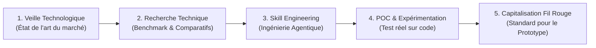
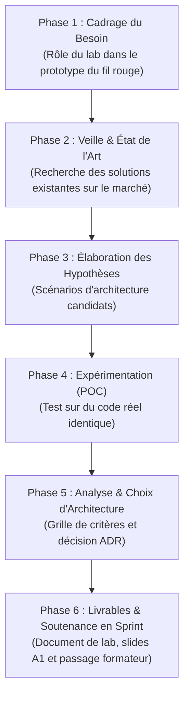

# Démarche Méthodologique : Réalisation d'un Lab Technique

Ce guide définit la démarche officielle pour traiter un sujet technique dans notre stack de développement avec les agents IA (**Claude Code**, **Google Antigravity**, **GitHub Copilot**).

---

## 1. La Nature de notre Travail : 4 Disciplines Complémentaires

Pour réaliser un Lab technique sur les agents IA, nous combinons 4 activités d'ingénierie logicielle :

| Activité | Rôle dans notre Lab |
| :--- | :--- |
| **1. Veille Technologique** *(State of the Art)* | Observer et explorer ce qui existe déjà sur le marché : dépôts officiels Anthropic (`claude-plugins-official`), spécifications ouvertes `agentskills.io`, documentations de Claude Code, Antigravity et Copilot. |
| **2. Recherche Technique** *(Technical Benchmark)* | Poser la bonne question d'architecture logicielle : comment découper nos outils ? Quels sont les avantages, inconvénients et compromis de chaque choix ? |
| **3. Le mot recherché : Le « Skill Engineering »** *(Ingénierie Agentique)* | C'est la discipline qui consiste à concevoir l'architecture des compétences d'un agent IA : définir la bonne granularité, gérer la mémoire (fenêtre de contexte / tokens), modulariser les règles (`rules/`) et orchestrer les outils (`tools`). |
| **4. POC / Prototypage** *(Proof of Concept / Spike Agile)* | Tester concrètement chaque option sur un cas réel de code (ex: un CRUD Laravel avec Alpine.js) pour mesurer la vitesse, la fiabilité et le nombre d'erreurs générées. |
| **5. Standardisation & Développement** | Transformer la solution retenue en standard d'équipe pour que chaque apprenant puisse l'utiliser dans son prototype de projet fil rouge. |

---

## 2. La Problématique d'Architecture : Comment organiser les Skills ?

Dans le cadre de notre projet fil rouge, la question clé d'architecture est : **Quelle est la bonne granularité pour nos Skills IA ?**

Trois grandes approches s'offrent à nous :

### Approche A : Un skill par Technologie
- **Exemple :** `skill-laravel`, `skill-alpinejs`, `skill-preline-ui`, `skill-mysql`.
- **Avantages :** Très précis techniquement, facile à maintenir par langage.
- **Inconvénients :** Risque de conflits entre compétences lors de l'assemblage, multiplication des fichiers dans le projet.

### Approche B : Un skill par Phase du Workflow
- **Exemple :** `skill-analyse`, `skill-conception`, `skill-realisation`, `skill-test`.
- **Avantages :** Aligné sur le cycle de vie logiciel et les sprints de développement.
- **Inconvénients :** Le skill de réalisation doit connaître toutes les technologies en même temps.

### Approche C : Un skill de Fonctionnalité Complète (Modèle Anthropic `feature-dev`)
- **Exemple :** Un skill maître (`feature-dev`) qui orchestre les phases d'exploration, de spécification, d'implémentation et de test de bout en bout.
- **Avantages :** Un seul point d'entrée pour l'apprenant, cohérence complète de la fonctionnalité développée.
- **Inconvénients :** Fichier de prompt plus long qui consomme plus de tokens de contexte.

### La Question de l'Orchestration Multi-Agents
Comment faire fonctionner nos skills sur les différents outils du marché :
- **Claude Code :** Utilisation en ligne de commande (CLI), exécution directe de scripts et de tests.
- **Antigravity :** IDE avec panneau de chat, gestion des règles globales (`rules/`) et des compétences d'équipe (`skills/`).
- **GitHub Copilot :** Complétion contextuelle et assistance au fil de l'eau dans l'éditeur.

---

## 3. Les Éléments Essentiels à ne pas Oublier

Pour qu'un Lab technique soit solide et validé devant le formateur, il ne suffit pas de trouver une solution, il faut respecter **4 critères d'ingénierie indispensables** :

1. **Les Critères Objectifs de Décision :**
   Définir sur quoi on juge la meilleure solution :
   - *Consommation de tokens :* Est-ce que le prompt est léger et rapide ?
   - *Facilité pour l'apprenant :* Est-ce simple à utiliser et à comprendre ?
   - *Non-duplication (DRY / SSOT) :* Les consignes sont-elles écrites en un seul endroit ?
   - *Zéro conflit :* Est-ce que les agents se mélangent les compétences ?
2. **Le Cas Test Étalon (Le « Testbench ») :**
   Pour comparer 2 architectures de skills, il faut tester **exactement le même cas de code** (par exemple : créer la gestion d'une ressource avec formulaire réactif Alpine.js et table de données Preline UI).
3. **Le Compte-Rendu de Décision (ADR - Architecture Decision Record) :**
   Écrire en 5 lignes pourquoi on a choisi telle option plutôt qu'une autre. Cela permet d'expliquer son choix avec assurance devant le formateur.
4. **La Préparation de la Soutenance en Sprint :**
   - Remplir la page de garde de la présentation.
   - Rédiger les **3 phrases simples de notes de l'orateur en français niveau A1** pour chaque slide.
   - Préparer la démonstration en direct (5 minutes max) et anticiper le mini-défi du formateur.

---

## 4. La Démarche Idéale en 6 Phases Pas-à-Pas

Voici le parcours méthodologique complet à suivre pour tout nouveau Lab technique :

### Phase 1 : Cadrage du Besoin
- Identifier la brique technique du prototype à réaliser (ex: CRUD Laravel, composant d'interface, skill IA).
- Formuler la question technique centrale en une phrase claire.
- Remplir le fichier `README.md` du lab.

### Phase 2 : Veille Technologique & État de l'Art
- Rechercher sur GitHub et les dépôts officiels (Anthropic, `agentskills.io`, Laravel, Tailwind).
- Lister les outils existants et les classer par ordre de pertinence.
- Identifier ce qui peut être réutilisé et ce qui doit être créé sur-mesure.

### Phase 3 : Formulation des Hypothèses Candidates
- Écrire 2 ou 3 manières différentes de concevoir la solution (ex: un skill unique vs plusieurs skills spécialisés).
- Définir le cas de test commun (le testbench).

### Phase 4 : Expérimentation & POC (Proof of Concept)
- Tester concrètement chaque hypothèse sur le projet de test.
- Observer les résultats : vitesse d'exécution, clarté du code généré, erreurs éventuelles.

### Phase 5 : Analyse Comparative & Décision
- Comparer les résultats selon la grille de critères.
- Choisir la solution optimale pour notre stack.
- Justifier ce choix par écrit dans la section théorique du lab.

### Phase 6 : Livrables & Soutenance en Sprint
- Initialiser le squelette de Lab (`Lab-[Nom].md`) et le suivi des tâches (`Todo.md`) avec le skill **`lab-dev`**.
- Concevoir le skill IA nécessaire selon les normes avec **`plugin-dev`**.
- Préparer la présentation avec la page de garde et les **3 phrases de notes en français A1** par slide.
- Faire la démonstration en direct (5 min) et réussir le mini-défi devant le formateur.

---

## 5. Synthèse & Checklist de Conduite d'un Lab

| Étape | Action concrète | Livrable produit | Statut |
| :---: | :--- | :--- | :---: |
| **1** | Cadrer le besoin pour le prototype | `README.md` complété | [ ] |
| **2** | Faire la veille sur les solutions existantes | Liens et références documentés | [ ] |
| **3** | Formuler 2 ou 3 options d'organisation | Hypothèses rédigées | [ ] |
| **4** | Coder le POC sur un cas test identique | Code de test fonctionnel | [ ] |
| **5** | Comparer et choisir la meilleure architecture | Choix justifié (ADR) | [ ] |
| **6** | Développer le skill IA avec `plugin-dev` | Dossier `.agent/skills/[nom]/` | [ ] |
| **7** | Rédiger le document de Lab | `Lab-[Nom].md` | [ ] |
| **8** | Préparer la présentation (Page de garde + Notes A1) | `Presentation-[Nom].md` | [ ] |
| **9** | Valider avec `lab-dev` et passer le sprint formateur | Validation Sprint obtenue | [ ] |

