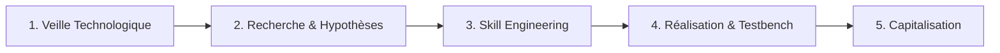

# Démarche Méthodologique d'un Lab Technique

## 1. Les 4 Activités d'Ingénierie

- **Veille :** Explorer les références existantes (`skills.sh`, Anthropic).
- **Hypothèses :** Poser les alternatives d'organisation (technologie, couche, workflow, skill unique).
- **Skill Engineering :** Définir la granularité et les règles des compétences IA.
- **Réalisation (Testbench) :** Tester sur un cas pratique étalon.
- **Capitalisation :** Standardiser pour le projet fil rouge.

## 2. Démarche en 6 Phases
1. **Phase 1 (Besoin) :** Cadrer le rôle dans le fil rouge (`1.besoin/contexte-et-besoin.md`).
2. **Phase 2 (Veille) :** Recenser les solutions du marché (`2.veille/veille-technologique.md`).
3. **Phase 3 (Hypothèses) :** Formuler les options d'architecture (`3.skill-technique/spec-skill.md`).
4. **Phase 4 (Expérimentation) :** Produire et tester le livrable (`4.realisation/`).
5. **Phase 5 (Arbitrage ADR) :** Choisir et justifier l'organisation retenue.
6. **Phase 6 (Soutenance) :** Rapport + Slides A1 (`5.rapport-et-presentation/`), sprint et mini-défi sans IA devant le formateur.

## 3. Règle Cardinale du Sprint
- **Projet Fil Rouge :** Développé à 100 % par l'IA selon notre architecture logicielle et nos skills.
- **Projet Technique (Prototype) :** Évalué en **live coding direct devant le formateur SANS IA et SANS PROMPT**.
