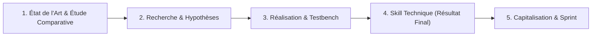

# Démarche Méthodologique d'un Lab Technique

## 1. Les 4 Activités d'Ingénierie

- **Étude Comparative :** Explorer les références existantes (`skills.sh`, GitHub Topics).
- **Hypothèses :** Poser les alternatives d'organisation (technologie, couche, workflow, skill unique).
- **Réalisation (Testbench) :** Expérimenter et comparer les options sur un cas pratique étalon (`4.realisation/`).
- **Spécification Technique du Skill :** Formaliser l'ADR et spécifier le skill retenu (`3.spec-skill/`).
- **Capitalisation & Sprint :** Rapport + Slides A1 (`5.rapport-et-presentation/`) et évaluation live coding sans IA.

## 2. Démarche en 5 Phases Pas-à-Pas
1. **Phase 1 (Besoin) :** Cadrer le problème dans `1.besoin/besoin.md` (assisté par `lab-dev`).
2. **Phase 2 (Étude Comparative) :** Recenser les références du marché et produire le diaporama Marp dans `2.etude-comparative/etude-comparative.md` (assisté par `w-etude-comparative`).
3. **Phase 3 (Expérimentation) :** Tester et comparer les options sur le cas pratique dans `4.realisation/` (skill technique itératif).
4. **Phase 4 (Spécification Technique du Skill) :** Retenir la démarche, rédiger `spec-skill.md` dans `3.spec-skill/` et finaliser le skill avec `w-spec-skill`.
5. **Phase 5 (Rapport & Soutenance) :** Finaliser `5.rapport-et-presentation/` avec `w-rapport` et passer le sprint sans IA devant le formateur.

## 3. Règle Cardinale du Sprint
- **Projet Fil Rouge :** Développé à 100 % par l'IA selon notre architecture logicielle et nos skills.
- **Projet Technique (Prototype) :** Évalué en **live coding direct devant le formateur SANS IA et SANS PROMPT**.
