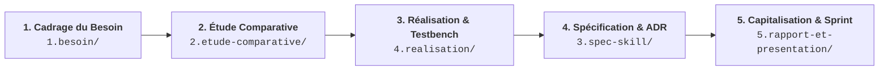

# Démarche Méthodologique d'un Lab Technique

Ce document formalise les fondements méthodologiques, le cycle de vie séquentiel et les règles cardinales d'évaluation pour l'ensemble des labs du référentiel Solicode / AgentDev.

---

## 1. Le Cycle d'Ingénierie en 5 Phases Séquentielles

Tout lab technique suit rigoureusement un cycle d'ingénierie articulé en 5 étapes ordonnées :

### Description des 5 Phases de Travail

1. **Phase 1 — Cadrage du Besoin (`1.besoin/`) :**
   - Identifier le problème technique réel sans présupposer d'une solution fermée.
   - Définir le périmètre fonctionnel attendu pour outiller l'agent `AgentDev`.
   - Livrable : `besoin.md` (assisté par `lab-dev`).

2. **Phase 2 — État de l'Art & Étude Comparative (`2.etude-comparative/`) :**
   - Explorer l'écosystème open-source (GitHub Topics, catalogues de skills, documentation officielle de notre stack).
   - Confronter plusieurs candidats sur une grille multicritères et recommander un plugin ou patron d'architecture de référence.
   - Livrable : `etude-comparative.md` au format Marp (assisté par `w-etude-comparative` et `marp-slide`).

3. **Phase 3 — Réalisation & Banc d'Essai (`4.realisation/`) :**
   - Construire le cas pratique étalon (ex: gestion des catégories) avec notre stack (PHP 8.2+ / Laravel 12 Service Layer + Alpine.js réactif) en mettant en œuvre le plugin recommandé.
   - Disséquer les phases et compétences du plugin, et analyser la manière dont ses skills sont architecturés.
   - Conclure en déduisant la stratégie pour `AgentDev` (créer notre propre jeu de skills ou adapter le plugin à notre stack).

4. **Phase 4 — Spécification Technique & Décision d'Architecture (`3.spec-skill/`) :**
   - Formaliser la décision d'architecture (ADR) à partir des mesures et conclusions de l'étape 3.
   - Rédiger la spécification formelle (`spec-skill.md`) et forger la compétence technique selon le standard Anthropic (10 rubriques).
   - Livrable : `spec-skill.md` et validation déterministe via `validate-skills.cjs` (assisté par `w-spec-skill`).

5. **Phase 5 — Capitalisation & Soutenance de Sprint (`5.rapport-et-presentation/`) :**
   - Rédiger le rapport technique consolidé (`Lab-[Sujet].md`) et le support oral (`Presentation-[Sujet].md`) avec page de garde réglementaire et exactement 3 phrases orales A1 par slide.
   - Réussir l'évaluation en live coding direct devant le formateur.
   - Livrables : rapport + slides (assisté par `w-rapport`).

---

## 2. Articulation Chronologique vs Numérotation des Dossiers

Dans la structure d'un lab, l'expérimentation terrain (**Phase 3 dans `4.realisation/`**) s'exécute chronologiquement **avant** la formalisation de la spécification (**Phase 4 dans `3.spec-skill/`**) :

> [!IMPORTANT]
> **Pourquoi le testbench précède-t-il la spécification du skill ?**  
> Une Décision d'Architecture (ADR) et un contrat d'interface fiable ne peuvent pas reposer sur des suppositions théoriques. L'apprenant doit obligatoirement éprouver le plugin et les composants sur le banc d'essai réel dans `4.realisation/` afin d'en mesurer la compatibilité de stack, la lisibilité et l'impact en tokens, avant de pouvoir arrêter et spécifier la compétence définitive dans `3.spec-skill/`.

---

## 3. Règle Cardinale du Sprint & Principe de Non-Substitution

L'évaluation et la gouvernance des labs reposent sur une dichotomie stricte :

| Axe de Réalisation | Responsable | Méthode & Environnement |
| :--- | :--- | :--- |
| **Projet Fil Rouge (100 % IA)** | **`AgentDev`** | Développé intégralement par l'agent d'ingénierie logicielle selon notre architecture, nos règles (`.agents/rules/`) et nos compétences. |
| **Prototype Sprint (100 % Humain)** | **L'Apprenant** | Démontré et codé en direct devant le formateur **SANS IA et SANS PROMPT**, garantissant la compréhension intime de chaque ligne de code. |

> [!CAUTION]
> **Principe de Non-Substitution :**  
> Les compétences de flux (`lab-dev`, `w-*`) assistent l'apprenant sur la méthode, le cadrage et la mise en page, mais **n'écrivent jamais le code du cas pratique ni les argumentaires critiques à la place de l'apprenant**. Les dossiers `4.realisation/` et `5.rapport-et-presentation/` sont initialisés avec leurs seuls fichiers `README.md` de consignes.
