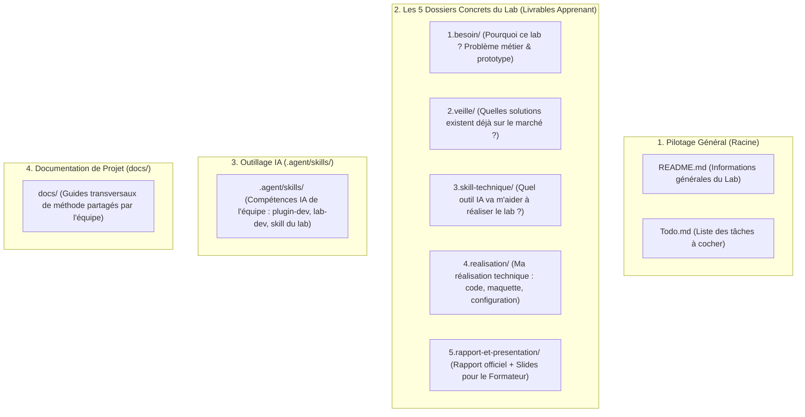

# Guide Méthodologique : Organisation des Fichiers et Dossiers d'un Lab

Ce guide explique comment organiser les dossiers d'un Lab technique pour travailler de manière claire, ordonnée et sans jamais oublier la présentation devant le formateur.

---

## 1. La Règle des 4 Espaces de Travail

Dans un projet de développement, nous séparons strictement 4 types de fichiers :



> [!IMPORTANT]
> **Règle Fondamentale sur le dossier `docs/` :**
> Le dossier `docs/` est réservé à la **documentation méthodologique et transversale** de notre équipe (comme ce guide ou le guide de démarche). **Aucun livrable d'un lab individuel ne doit être déposé dans `docs/`**.

---

## 2. L'Arborescence Complète d'un Lab

```
mon-lab-technique/
│
├── README.md                          # Informations générales sur le Lab (sujet, fil rouge, stack)
├── Todo.md                            # Suivi ordonné des tâches à cocher par l'apprenant
│
├── 1.besoin/                          # [Étape 1] Pourquoi ce lab ? Problème métier et technique
│   └── contexte-et-besoin.md          # (Rempli à partir du template guidé)
│
├── 2.veille/                          # [Étape 2] État de l'art et solutions existantes
│   └── veille-technologique.md        # Benchmark, outils communautaires, comparatifs
│
├── 3.skill-technique/                 # [Étape 3] Spécification du Skill IA créé pour ce lab
│   └── spec-skill.md                  # Règles techniques du sujet (lié à .agent/skills/lab-[nom]/)
│
├── 4.realisation/                     # [Étape 4] Réalisation technique concrète testée
│   └── [fichiers de code, maquettes, schémas ou configurations selon le sujet]
│
├── 5.rapport-et-presentation/         # [Étapes 5 & 6] Les deux livrables réunis pour le formateur
│   ├── Lab-[Sujet].md                 # Le rapport technique officiel (Théorie & Pratique)
│   └── Presentation-[Sujet].md        # Les slides (Page de garde + Notes A1 par slide)
│
├── .agent/skills/                     # Compétences IA utilisables par Antigravity / Claude Code
│   ├── plugin-dev/                    # Méta-gouvernance des skills
│   ├── lab-dev/                       # Méta-méthodologie & suivi du lab
│   └── lab-[nom]/                     # Skill technique dédié au sujet du lab
│
└── docs/                              # Guides de méthode de l'équipe (transversal)
    ├── 01-demarche-realisation-lab.md
    └── 02-organisation-fichiers-lab.md
```

---

## 3. Détail des 5 Dossiers du Lab

### 1. `1.besoin/` : Expliquer pourquoi on fait ce Lab
Ce dossier contient `contexte-et-besoin.md`. L'apprenant y répond à 5 questions simples :
- Quel est mon projet fil rouge ?
- Quelle partie de mon prototype je développe ?
- Quel problème technique précis je dois résoudre ?
- Où se situe cette brique dans notre stack ?
- Quels sont mes critères de réussite ?

### 2. `2.veille/` : Trouver ce qui existe déjà
Ce dossier contient `veille-technologique.md`. L'apprenant y note :
- Les outils et librairies trouvés sur GitHub ou la documentation officielle.
- Les solutions déjà existantes.
- Pourquoi nous développons notre propre solution adaptée à nos besoins.

### 3. `3.skill-technique/` : Préparer l'assistance IA
Ce dossier contient `spec-skill.md`. L'apprenant y définit :
- Le nom du skill IA dédié au lab (ex: `lab-crud-laravel`, `lab-skill-engineering`).
- Les 3 à 5 règles techniques obligatoires de la technologie.
- Le lien avec le skill créé sous `.agent/skills/lab-[nom]/` avec `plugin-dev`.

### 4. `4.realisation/` : La production technique concrète
Le terme *« réalisation »* est universel :
- Si c'est un lab de développement web : on y place le **code source** (PHP, JS, Blade, SQL).
- Si c'est un lab de design/UX : on y place les **maquettes et composants UI**.
- Si c'est un lab d'architecture ou de skills (comme le lab actuel) : on y place les **matrices, fiches de compétences et configurations**.

### 5. `5.rapport-et-presentation/` : Les deux livrables réunis pour le formateur
Ce dossier regroupe les deux pièces évaluées lors du sprint :
1. **`Lab-[Sujet].md` :** Le rapport technique complet qui explique la théorie, la solution choisie (ADR) et les étapes pratiques.
2. **`Presentation-[Sujet].md` :** Les diapositives de soutenance avec obligatoirement :
   - Une **page de garde complète** (titre, nom, date, fil rouge, stack).
   - **Exactement 3 phrases simples de notes de l'orateur en français niveau A1** pour chaque slide.

---

## 4. Pourquoi ce Système Évite d'Oublier la Présentation ?

Dans beaucoup de projets, la présentation est oubliée car elle est traitée comme une corvée à la dernière minute.
Avec notre organisation :
1. **Dès le premier jour**, le dossier `5.rapport-et-presentation/` est créé avec son fichier `Presentation-[Sujet].md`.
2. **L'apprenant remplit une slide à la fois**, au fur et à mesure qu'il avance dans les dossiers 1, 2, 3 et 4.
3. **Le skill `lab-dev` vérifie la présentation** avant de donner l'autorisation de passer en sprint devant le formateur.

