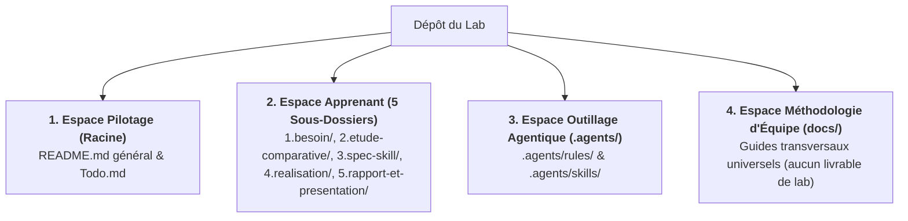

# Guide d'Organisation des Fichiers d'un Lab

Ce guide détaille l'organisation structurelle de l'arborescence, la séparation étanche des espaces de travail et le rôle des fichiers `README.md` locaux pour l'ensemble des labs du référentiel Solicode / AgentDev.

---

## 1. La Règle des 4 Espaces de Travail

Pour garantir la maintenabilité, la lisibilité et le respect des principes SSOT (Source Unique de Vérité) et DRY (Ne Pas Se Répéter), chaque dépôt de lab est segmenté en 4 espaces étanches :



### Détail des 4 Espaces

1. **Espace Pilotage (Racine du Projet) :**
   - `README.md` : Fiche d'identité unique du lab (titre, sujet, objectif pédagogique, stack technique). C'est la porte d'entrée obligatoire (Gate 0).
   - `Todo.md` : Tableau de bord dynamique permettant de suivre l'état d'avancement des phases et le franchissement des Quality Gates.

2. **Espace Apprenant (Les 5 Sous-Dossiers Séquentiels) :**
   - `1.besoin/` : Cadrage du problème et expression du besoin (`besoin.md`).
   - `2.etude-comparative/` : Consignes (`README.md`) et diaporama Marp de confrontation des solutions (`etude-comparative.md`).
   - `3.spec-skill/` : Consignes (`README.md`), décision d'architecture (ADR) et spécification technique formelle (`spec-skill.md`).
   - `4.realisation/` : Consignes (`README.md`) et banc d'essai étalon développé avec le plugin recommandé.
   - `5.rapport-et-presentation/` : Consignes (`README.md`), rapport technique (`Lab-[Sujet].md`) et diaporama oral (`Presentation-[Sujet].md`).

3. **Espace Outillage Agentique (`.agents/`) :**
   - `.agents/rules/` : Règles de gouvernance transversales (`persona.md`, `lab-rules.md`, `stack-principles.md`).
   - `.agents/skills/` : Compétences d'orchestration (`lab-dev`), de normalisation (`skill-creator`), de flux (`w-*`) et skill technique dédié au domaine.

4. **Espace Méthodologie d'Équipe (`docs/`) :**
   - Guides méthodologiques universels applicables à tous les labs. Cet espace ne contient aucun code ni livrable propre à un lab particulier.

---

## 2. Le Rôle des Fichiers `README.md` Locaux

Chaque sous-dossier de l'espace apprenant comporte obligatoirement son propre fichier `README.md` :

> [!NOTE]
> **Pourquoi un `README.md` dans chaque sous-dossier ?**
> 1. **Contrat de Phase Local :** Il énonce clairement à l'apprenant l'objectif de l'étape, la démarche attendue et les consignes pas à pas.
> 2. **Garant du Principe de Non-Substitution :** Les dossiers d'expérimentation (`4.realisation/`) et de soutenance (`5.rapport-et-presentation/`) sont initialisés avec **uniquement** leur `README.md`. L'assistant IA n'y injecte pas la solution à l'avance.
> 3. **Critères de Quality Gate :** Le `README.md` liste la checklist binaire requise pour valider l'étape et obtenir l'autorisation de passer à la suivante.

---

## 3. Arborescence Type : Initialisation vs Clôture

Le tableau ci-dessous illustre l'évolution normale de l'arborescence entre le démarrage du lab et sa finalisation par l'apprenant :

```
État Initial (Scaffolding lab-dev)          État Final (Après Travail Apprenant)
mon-lab/                                     mon-lab/
├── README.md (Fiche d'identité)             ├── README.md
├── Todo.md (Jalons à cocher)                ├── Todo.md (Toutes gates cochées)
├── 1.besoin/                                ├── 1.besoin/
│   └── besoin.md                            │   └── besoin.md (Validé Gate 1)
├── 2.etude-comparative/                     ├── 2.etude-comparative/
│   ├── README.md (Consignes)                │   ├── README.md
│   └── etude-comparative.md (Amorces Marp)  │   └── etude-comparative.md (Diaporama complété)
├── 3.spec-skill/                            ├── 3.spec-skill/
│   └── README.md (Consignes)                │   ├── README.md
│                                            │   └── spec-skill.md (ADR + Spécification)
├── 4.realisation/                           ├── 4.realisation/
│   └── README.md (Consignes du banc)        │   ├── README.md
│                                            │   └── [Code & mesures du cas étalon]
├── 5.rapport-et-presentation/               ├── 5.rapport-et-presentation/
│   └── README.md (Consignes de soutenance)  │   ├── README.md
│                                            │   ├── Lab-[Sujet].md (Rapport technique)
│                                            │   └── Presentation-[Sujet].md (Slides A1)
└── docs/                                    └── docs/
```

---

## 4. Invariants Réglementaires de la Soutenance

Tout livrable présenté lors du sprint d'évaluation finale doit respecter 3 exigences strictes :
1. **Page de Garde Obligatoire :** Tableau d'en-tête récapitulant : Titre du Lab, Apprenant, Rôle d'AgentDev (Projet Fil Rouge 100 % IA), Prototype Sprint (Live coding sans IA), Stack technique.
2. **Notes Orales Réglementaires :** Exactement **3 phrases simples en français de niveau A1** par diapositive, rédigées par l'apprenant.
3. **Live Coding sans IA :** Démonstration directe et réalisation d'un mini-défi en direct devant le formateur **sans assistance de l'IA et sans prompt**.
