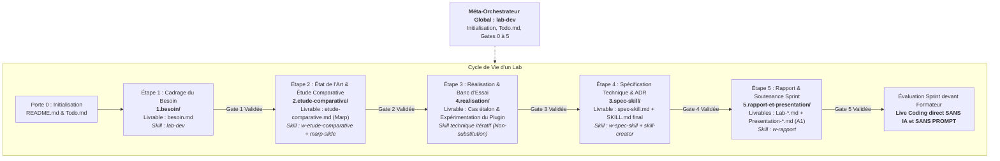

# Flux de Travail Standardisé d'un Lab Technique

Ce document constitue la référence officielle du cycle de vie, des compétences d'accompagnement et des portes de passage (*Quality Gates*) pour l'ensemble des labs du référentiel Solicode / AgentDev.

---

## 1. Vue d'Ensemble du Flux de Travail

Le déroulement d'un Lab s'articule autour de **5 étapes ordonnées**, réparties dans 5 sous-dossiers et rythmées par 6 portes de qualité séquentielles (Gates 0 à 5) :

---

## 2. Détail des 5 Étapes du Flux

### Étape 1 : Cadrage du Besoin (`1.besoin/`)
- **Objectif :** Expliciter le problème technique réel et définir le périmètre de la compétence requise pour notre agent `AgentDev` sur le projet fil rouge.
- **Livrable attendu :** `1.besoin/besoin.md`.
- **Règles clés :**
  - Respect strict de SSOT : ne pas dupliquer le persona ou le contexte global déjà consigné dans `.agents/rules/persona.md`.
  - Ouverture méthodologique : ne pas enfermer le besoin dans un choix arbitraire, laisser la porte ouverte aux approches hybrides ou alternatives.
- **Compétence IA associée :** **`lab-dev`** (Méta-skill d'orchestration).

---

### Étape 2 : État de l'Art & Étude Comparative (`2.etude-comparative/`)
- **Objectif :** Explorer les dépôts open-source (GitHub Topics, catalogues `skills.sh`, standards communautaires, documentation officielle de stack), comparer les solutions candidates sur grille multicritères et recommander un plugin ou pattern de référence.
- **Livrables attendus :**
  - `2.etude-comparative/README.md` : feuille de route et consignes de recherche pour l'apprenant.
  - `2.etude-comparative/etude-comparative.md` : présentation au format **Marp** (`marp: true`, thème `tech` ou `business`).
- **Guide méthodologique associé :** [`docs/04-guide-etude-comparative.md`](./04-guide-etude-comparative.md).
- **Compétences IA associées :** **`w-etude-comparative`** (Skill de flux) combiné avec **`marp-slide`**.

---

### Étape 3 : Réalisation & Banc d'Essai (`4.realisation/`)
- **Objectif :** Concrétiser le cas pratique étalon (ex: CRUD des Catégories) conforme à notre stack (**PHP 8.2+ / Laravel 12 avec Service Layer, DTOs, Form Requests et Alpine.js réactif**) en utilisant le **plugin recommandé par l'étude comparative**, disséquer son fonctionnement et en déduire la stratégie de modélisation pour `AgentDev`.
- **Démarche en 3 temps :**
  1. *Réalisation concrète :* Développer l'application étalon en suivant le cycle du plugin de référence.
  2. *Rétro-ingénierie :* Présenter les compétences (skills) et les phases mobilisées par le plugin, et décrire l'architecture de skills adoptée.
  3. *Conclusion stratégique :* Arbitrer entre la création de nos propres compétences adoptant cette architecture ou l'adaptation du plugin à notre stack.
- **Livrables attendus :**
  - `4.realisation/README.md` : consignes du banc d'essai (initialement seul fichier présent).
  - Code source développé par l'apprenant et analyse réflexive du plugin.
- **Règle cardinale :** **Non-substitution.** L'agent IA n'écrit pas le code à la place de l'apprenant.

---

### Étape 4 : Spécification Technique & ADR (`3.spec-skill/`)
- **Objectif :** Transformer les conclusions de l'étape 3 en décision d'architecture formelle (ADR), formaliser la spécification technique du skill (`spec-skill.md`) et finaliser la compétence dans `.agents/skills/[domaine-brique]/SKILL.md`.
- **Livrables attendus :**
  - `3.spec-skill/README.md` : consignes de spécification.
  - `3.spec-skill/spec-skill.md` : ADR, contrat d'interface et matrice stack.
  - `.agents/skills/[domaine-brique]/SKILL.md` : compétence normée (10 rubriques Anthropic).
- **Règle clé :** Validation déterministe obligatoire à 100 % via `node .agents/skills/skill-creator/scripts/validate-skills.cjs`. Le préfixe `lab-*` est strictement interdit pour les noms de compétences techniques.
- **Compétences IA associées :** **`w-spec-skill`** (Skill de flux) en articulation avec **`skill-creator`**.

---

### Étape 5 : Rapport & Soutenance Sprint (`5.rapport-et-presentation/`)
- **Objectif :** Capitaliser l'ensemble du lab dans le rapport technique (`Lab-[Sujet].md`), préparer les diapositives de présentation orale (`Presentation-[Sujet].md`) et s'entraîner au live coding sans IA.
- **Livrables attendus :**
  - `5.rapport-et-presentation/README.md` : consignes de soutenance (initialement seul fichier présent).
  - `Lab-[Sujet].md` : rapport technique complet alimenté par les données réelles du testbench.
  - `Presentation-[Sujet].md` : diapositives avec **page de garde obligatoire sous forme de tableau** et exactement **3 phrases simples orales en français A1** par slide.
- **Règle cardinale :** L'évaluation finale s'effectue en direct devant le formateur **SANS IA et SANS PROMPT**.
- **Compétence IA associée :** **`w-rapport`** (Skill de flux).

---

## 3. Matrice des Compétences IA par Rôle

| Catégorie | Compétence | Source | Rôle Principal |
| :--- | :--- | :--- | :--- |
| **Méta-Gouvernance** | `lab-dev` | Interne | Initialisation du lab, gestion de `Todo.md`, cadrage du besoin (`besoin.md`), audit des gates. |
| **Méta-Standard** | `skill-creator` | Interne | Gouvernance, outillage et validation déterministe des skills selon le standard Anthropic (10 rubriques). |
| **Skills de Flux** | `w-etude-comparative` | `w-*` (Interne) | Accompagnement de l'état de l'art, de l'étude comparative et génération du diaporama Marp (`2.etude-comparative/`). |
| **Skills de Flux** | `w-spec-skill` | `w-*` (Interne) | Spécification technique, formalisation de l'ADR consécutive au testbench (`3.spec-skill/`). |
| **Skills de Flux** | `w-rapport` | `w-*` (Interne) | Rédaction du rapport, calibration des notes orales A1 et préparation à la soutenance (`5.rapport-et-presentation/`). |
| **Skill Outil Installé** | `marp-slide` | Externe (`skills-lock.json`) | Moteur de rendu des présentations visuelles Marp (`theme: tech` ou `business`). |
| **Skills Techniques** | `[domaine]-[brique]` | Interne | Compétences expertes du domaine (ex: `architecture-skills`, `alpine-components`) testées puis spécifiées. |

---

## 4. Portes de Passage Qualité (*Quality Gates*)

| Porte | Étape Associée | Critère Binaire d'Approbation | Action Bloquante si Non-Conforme |
| :---: | :--- | :--- | :--- |
| **Gate 0** | Racine | `README.md` complété (titre, sujet, objectif) + `Todo.md` initialisé. | Arrêt immédiat tant que le `README.md` n'est pas renseigné. |
| **Gate 1** | 1.besoin | Problématique claire, pas de redondance de contexte, ouverture aux alternatives (`besoin.md`). | Refus de passage à l'étape 2 et demande de reformulation. |
| **Gate 2** | 2.etude-comparative | Sources réelles identifiées, grille comparative remplie, recommandation du plugin formulée, présentation Marp générée (`etude-comparative.md`). | Obligation de compléter le comparatif avant de coder. |
| **Gate 3** | 4.realisation | Cas étalon fonctionnel développé avec le plugin recommandé, phases et architecture de skills disséquées, déduction pour `AgentDev` formulée. | Interdiction formelle de rédiger la spécification ou l'ADR sans testbench réel. |
| **Gate 4** | 3.spec-skill | `spec-skill.md` rédigé (ADR + contrat d'interface) et `validate-skills.cjs` confirme **0 erreur**. | Blocage tant que la compétence n'est pas 100 % conforme. |
| **Gate 5** | 5.rapport | Page de garde présente + exactement 3 notes A1/slide + maîtrise du code sans IA attestée. | Refus d'autorisation de passage devant le formateur. |
