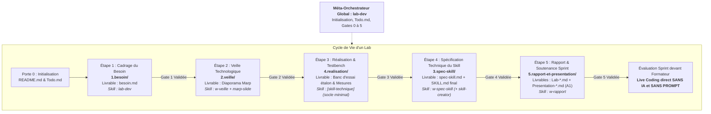

# Flux de Travail Standardisé d'un Lab Technique

Ce document constitue la référence officielle du cycle de vie et du flux de travail (workflow) pour tout Lab technique au sein du référentiel Solicode / AgentDev.

---

## 1. Vue d'Ensemble du Flux de Travail

Le développement d'un Lab s'articule autour de **5 étapes ordonnées**, matérialisées par 5 sous-dossiers concrets et rythmées par des portes de passage strictes (*Quality Gates*) :

---

## 2. Détail des 5 Étapes du Flux

### Étape 1 : Cadrage du Besoin (`1.besoin/`)
- **Objectif :** Poser le cadre du lab, identifier le problème technique concret et expliciter le besoin d'outillage pour l'agent `AgentDev` sur le projet fil rouge.
- **Livrable attendu :** `1.besoin/besoin.md`.
- **Règle clé (SSOT / DRY) :** Ne pas répéter le contexte global (déjà défini et invariable dans `.agents/rules/persona.md`). Ouvrir explicitement la démarche à des alternatives ou architectures hybrides au-delà des 4 pistes exploratoires initiales.
- **Compétence IA associée :** **`lab-dev`** (Méta-skill de cadrage et gouvernance).

---

### Étape 2 : Veille Technologique (`2.veille/`)
- **Objectif :** Établir l'état de l'art, analyser les composants et compétences disponibles sur les dépôts de référence (notamment [`https://github.com/topics/coding-agent`](https://github.com/topics/coding-agent), `skills.sh`, dépôts officiels Anthropic, et documentations de notre stack Laravel 12 / Alpine.js).
- **Livrables attendus :**
  - `2.veille/README.md` : consignes et critères de recherche pour l'apprenant.
  - `2.veille/veille-technologique.md` : diaporama rédigé au format **Marp** (thème `tech` ou `business`).
- **Guide méthodologique associé :** [`docs/04-guide-veille-technologique.md`](./04-guide-veille-technologique.md).
- **Compétences IA associées :** **`w-veille`** (Skill de flux) combiné avec le skill installé **`marp-slide`**.

---

### Étape 3 : Réalisation & Expérimentation (`4.realisation/`)
- **Objectif :** Monter le testbench étalon commun (cas pratique concret, ex: Landing Page des Lauréats), tester les hypothèses et comparer les approches (brute vs adaptée à notre stack).
- **Livrables attendus :**
  - `4.realisation/README.md` : consignes du testbench.
  - Code source de démonstration et relevé des métriques comparatives (lisibilité, vitesse d'exécution, consommation de tokens, maintenabilité).
- **Démarche itérative du skill :** Cette étape fait appel au **skill technique dédié du lab** (ex: `architecture-skills`, `alpine-components`), instancié avec un **socle minimal de règles**, puis enrichi progressivement au fil des tests.
- **Règle pédagogique cardinale :** **Non-substitution.** L'assistant ne rédige pas le code de testbench à la place de l'apprenant.

---

### Étape 4 : Spécification Technique du Skill (`3.spec-skill/`)
- **Objectif :** À partir des métriques et constats de l'étape 3, formaliser la décision d'architecture (ADR), rédiger la spécification technique (`spec-skill.md`) et finaliser le skill technique officiel sous `.agents/skills/[domaine-brique]/SKILL.md`.
- **Livrables attendus :**
  - `3.spec-skill/README.md` : consignes de spécification.
  - `3.spec-skill/spec-skill.md` : ADR et contrat d'interface.
  - `.agents/skills/[domaine-brique]/SKILL.md` : compétence validée (10 rubriques Anthropic).
- **Règle clé :** Le skill technique final doit obtenir 0 erreur lors du contrôle déterministe par `validate-skills.cjs`. Le préfixe `lab-*` est strictement interdit pour le nom du skill technique.
- **Compétences IA associées :** **`w-spec-skill`** (Skill de flux) en articulation avec **`skill-creator`**.

---

### Étape 5 : Rapport & Soutenance Sprint (`5.rapport-et-presentation/`)
- **Objectif :** Formaliser la synthèse du lab dans le rapport technique (`Lab-[Sujet].md`) et préparer les diapositives de présentation (`Presentation-[Sujet].md`).
- **Livrables attendus :**
  - `Lab-[Sujet].md` : rapport technique complété à partir des données réelles d'expérimentation.
  - `Presentation-[Sujet].md` : diapositives avec **page de garde obligatoire** et exactement **3 phrases simples de notes orales en français A1** par slide.
- **Règle clé du sprint :** Préparer le candidat à réussir le **mini-défi en live coding direct devant le formateur SANS IA et SANS PROMPT**.
- **Compétence IA associée :** **`w-rapport`** (Skill de flux).

---

## 3. Matrice des Compétences IA par Rôle

| Catégorie | Compétence | Format / Source | Rôle Principal |
| :--- | :--- | :--- | :--- |
| **Méta-Gouvernance** | `lab-dev` | Interne | Initialisation du lab, gestion de `Todo.md`, cadrage du besoin (`besoin.md`), validation des portes. |
| **Méta-Standard** | `skill-creator` | Interne | Conception et validation déterministe des skills selon le standard Anthropic (10 rubriques). |
| **Skills de Flux** | `w-veille` | `w-*` (Interne) | Accompagnement de l'état de l'art, du benchmark et génération du diaporama Marp (`2.veille/`). |
| **Skills de Flux** | `w-spec-skill` | `w-*` (Interne) | Spécification technique, rédaction de l'ADR et pilotage de la finalisation du skill (`3.spec-skill/`). |
| **Skills de Flux** | `w-rapport` | `w-*` (Interne) | Rédaction du rapport, calibration des slides A1 et préparation de la soutenance (`5.rapport-et-presentation/`). |
| **Skill Outil Installé** | `marp-slide` | Externe (`skills-lock.json`) | Moteur de génération des diapositives professionnelles au format Marp. |
| **Skills Techniques** | `[domaine]-[brique]` | Interne | Compétences expertes opérationnelles utilisées de façon itérative (Étape 3) puis figées (Étape 4). |

---

## 4. Portes de Passage Qualité (*Quality Gates*)

| Porte | Étape | Critère Binaire d'Approbation | Action Bloquante si Non-Conforme |
| :---: | :--- | :--- | :--- |
| **Gate 0** | Racine | `README.md` complété + `Todo.md` initialisé. | Arrêt immédiat tant que le `README.md` n'est pas renseigné. |
| **Gate 1** | 1.besoin | Problématique claire, pas de répétition de contexte, ouverture sur alternatives (`besoin.md`). | Reformuler `besoin.md`. |
| **Gate 2** | 2.veille | Sources officielles identifiées (GitHub Topics, `skills.sh`), présentation Marp générée. | Compléter le diaporama de veille. |
| **Gate 3** | 4.realisation | Testbench fonctionnel monté, métriques comparatives collectées. | Interdiction de valider le skill technique sans banc d'essai. |
| **Gate 4** | 3.spec-skill | `spec-skill.md` rédigé + `validate-skills.cjs` affiche 0 erreur. | Corriger les rubriques ou YAML du skill. |
| **Gate 5** | 5.rapport | Page de garde présente + 3 notes A1/slide + prêt pour le live coding sans IA. | Refus de validation de soutenance. |

