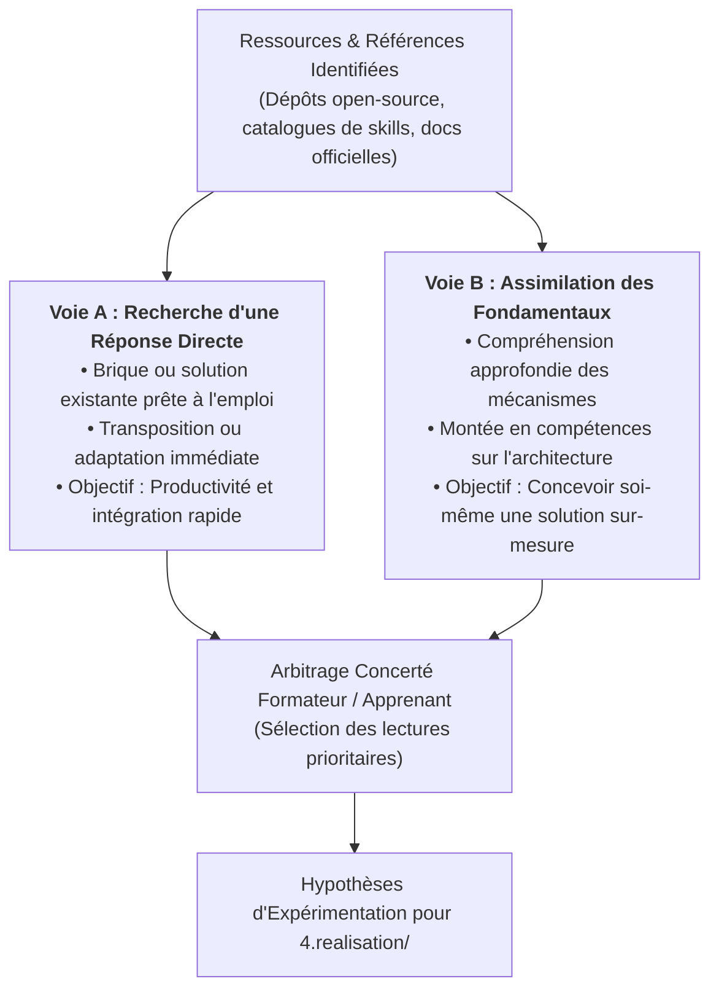

# Guide Méthodologique : Qu'est-ce qu'une Étude Comparative / État de l'Art et Comment la Réaliser ?

> **Portée :** Ce document est un guide méthodologique transversal (`docs/`). Il est **universel et applicable à l'ensemble des labs techniques** du référentiel, quel que soit le domaine abordé (backend, frontend réactif, design system, persistance, architecture logicielle ou ingénierie agentique).

---

## 1. Définition & Finalité de l'Étude Comparative dans un Lab

Dans tout lab technique, l'**état de l'art et l'étude comparative des solutions** (Étape 2 du workflow) constitue la phase d'investigation préalable à toute écriture de code :
- **Ne jamais réinventer la roue :** Avant de concevoir une brique logicielle ou une compétence IA, cartographier l'existant pour réutiliser les standards éprouvés par l'écosystème open-source.
- **Identifier les meilleures pratiques :** Analyser les conventions de conception, les patterns d'implémentation et les limites des bibliothèques ou compétences existantes sur le sujet étudié.
- **Formuler les hypothèses de réalisation :** Une étude comparative rigoureuse n'est pas un résumé passif ; elle débouche obligatoirement sur des hypothèses techniques concrètes et comparables qui seront testées sur le banc d'essai étalon (`4.realisation/`).

---

## 2. La Double Démarche d'Exploitation Pédagogique

Face aux références recensées lors de la veille, le binôme **formateur / apprenant** oriente systématiquement l'analyse selon deux voies complémentaires :

1. **Voie A (Réponse Directe) :**
   - *Quand la mobiliser :* Lorsqu'une bibliothèque, un patron ou un skill public résout déjà fidèlement la problématique posée.
   - *Intérêt :* Valider la capacité à intégrer et adapter rapidement une solution tierce au sein de notre stack.
2. **Voie B (Assimilation des Fondamentaux) :**
   - *Quand la mobiliser :* Lorsqu'aucune solution prête à l'emploi ne respecte nos contraintes architecturales (ex: couplage excessif, complexité inutile, consommation de tokens disproportionnée, non-conformité avec nos versions de stack).
   - *Intérêt :* Étudier la documentation de référence et les concepts clés pour maîtriser la technologie et forger soi-même la solution idoine.

---

## 3. Typologie des Gisements de Référence pour Tous les Labs

Chaque lab mobilise des gisements documentaires adaptés à son sujet technique, articulés autour de 4 piliers majeurs :

### Pilier 1 : Dépôts Open-Source & GitHub Topics
- **Carrefour mondial des Topics GitHub :** 
  - [`https://github.com/topics/coding-standards`](https://github.com/topics/coding-standards) : standards de code, règles d'ingénierie et bonnes pratiques logicielles.
  - [`https://github.com/topics/coding-agent`](https://github.com/topics/coding-agent) : agents de développement, compétences et architectures multi-agents.
  - [`https://github.com/topics/agent-skills`](https://github.com/topics/agent-skills) : bibliothèques de compétences prêtes pour les agents de code.
  - Topics spécifiques au sujet du lab (ex: `laravel`, `alpinejs`, `tailwindcss`, `cursor-rules`).
- **Cas d'école remarquable :** Le standard ouvert [`HoangNguyen0403/agent-skills-standard`](https://github.com/HoangNguyen0403/agent-skills-standard) qui structure les compétences d'agents par niveaux de priorité P0 (architecture, Eloquent, sécurité) et P1 (testing, API).
- **Objectif :** Examiner les dépôts vivants, les commits récents, les discussions d'architectes et la structure des projets réels.

### Pilier 2 : Catalogues & Registres de Compétences IA
- **Sources :** [`skills.sh`](https://skills.sh), [`agentskills.io`](https://agentskills.io), dépôts officiels des éditeurs (ex: Anthropic `claude-plugins-official`).
- **Objectif :** Observer comment la communauté formule les règles d'instructions, structure la granularité et encadre l'assistance de l'agent.

### Pilier 3 : Documentations Officielles de la Stack
- **Sources :** Portails officiels de nos briques techniques (PHP / Laravel, JavaScript / Alpine.js, Tailwind CSS, Preline UI, moteurs de base de données).
- **Objectif :** Disposer de la source unique de vérité sur les APIs, les versions ciblées, la sécurité et les bonnes pratiques canoniques.

### Pilier 4 : Guides Pédagogiques & Retours d'Expérience
- **Sources :** Articles d'architecture, benchmarks de performance, cas d'école.
- **Objectif :** Anticiper les pièges fréquents et nourrir la réflexion critique de l'apprenant.

---

## 4. Méthodologie d'Exécution Pas-à-Pas (Valable pour Tout Lab)

1. **Étape 1 - Cadrer le Périmètre de Recherche :**
   - Extraire de `1.besoin/besoin.md` le problème technique précis et identifier 3 à 5 mots-clés d'exploration.
2. **Étape 2 - Sourcing & Recensement :**
   - Sonder les plateformes (GitHub Topics, catalogues de skills, documentations officielles).
   - Isoler 2 à 4 candidats ou approches contrastées.
3. **Étape 3 - Grille d'Analyse Comparative :**
   - Évaluer chaque candidat selon 4 critères universels :
     - *Adéquation Fonctionnelle :* Résout-il le cas d'usage ciblé dans le prototype ?
     - *Conformité Stack :* S'intègre-t-il proprement sans conflit de version ni dépendance superflue ?
     - *Sobriété & Empreinte Contextuelle :* Est-il léger, modulaire et économe en tokens/ressources ?
     - *Maintenabilité :* Est-il facilement compréhensible et explicable par l'apprenant lors du sprint sans IA ?
4. **Étape 4 - Arbitrage avec le Formateur :**
   - Présenter les pistes retenues et décider des lectures approfondies (part de réponse directe vs part d'apprentissage des bases).
5. **Étape 5 - Formulation des Hypothèses pour le Banc d'Essai :**
   - Formuler au minimum 2 hypothèses concrètes à départager lors de l'étape 3 (`4.realisation/`) (ex: comparer une approche issue de la veille brute contre une approche adaptée sur-mesure).

---

## 5. Restitution Standardisée : Le Diaporama Marp

Quel que soit le sujet du lab, le résultat de l'étude comparative est obligatoirement restitué sous la forme d'un **diaporama Marp** (`2.etude-comparative/etude-comparative.md`) :
- **Rôle du format :** Offrir un support de synthèse visuel, professionnel et concis, exécutable dans le navigateur ou exportable en PDF/HTML.
- **Outillage :** Mobiliser le skill **`marp-slide`** pour appliquer un thème soigné (`tech`, `business` ou `minimal`).
- **Gabarit standard en 5 diapositives pour tout lab :**
  - **Slide 1 :** Page de garde (Titre du lab, sujet technique de l'étude comparative, apprenant, date).
  - **Slide 2 :** Problématique technique et objectifs de l'étude comparative pour le prototype.
  - **Slide 3 :** Panorama des références et dépôts explorés (avec liens vérifiables).
  - **Slide 4 :** Tableau comparatif multicritères des solutions étudiées.
  - **Slide 5 :** Synthèse d'arbitrage et hypothèses d'expérimentation pour l'étape 3 (`4.realisation/`).
