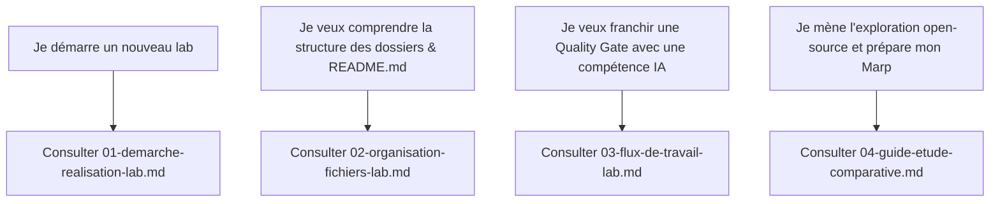

# Sommaire des Guides Méthodologiques Transversaux (`docs/`)

Ce dossier héberge la documentation méthodologique de référence, **universelle et applicable à l'ensemble des labs techniques** du référentiel Solicode / AgentDev.

---

## 📚 Les 4 Guides Transversaux de Référence

| Guide | Fichier | Objectif & Portée | Public / Usage |
| :--- | :--- | :--- | :--- |
| **01. Démarche** | [`01-demarche-realisation-lab.md`](./01-demarche-realisation-lab.md) | Cycle d'ingénierie en 5 phases séquentielles, distinction Projet Fil Rouge (100 % IA) vs Prototype Sprint (Live coding sans IA), principe de non-substitution. | Vue d'ensemble pour démarrer tout lab. |
| **02. Organisation** | [`02-organisation-fichiers-lab.md`](./02-organisation-fichiers-lab.md) | Règle des 4 espaces étanches, rôle des fichiers `README.md` locaux de consignes, arborescence type au démarrage et à la clôture. | Structure de dossiers & règles SSOT/DRY. |
| **03. Flux de Travail** | [`03-flux-de-travail-lab.md`](./03-flux-de-travail-lab.md) | Détail des 5 étapes du workflow, compétences IA de flux (`w-*`) et méta-gouvernance (`lab-dev`, `skill-creator`), checklist des 6 Quality Gates. | Pilotage pas à pas et validation des jalons. |
| **04. Étude Comparative** | [`04-guide-etude-comparative.md`](./04-guide-etude-comparative.md) | Méthode d'investigation préalable, gisements mondiaux (GitHub Topics, catalogues de skills), double démarche (Voies A/B), format Marp en 5 slides. | Réalisation de l'Étape 2 et recommandation du plugin. |

---

## 🧭 Matrice d'Orientation Rapide

